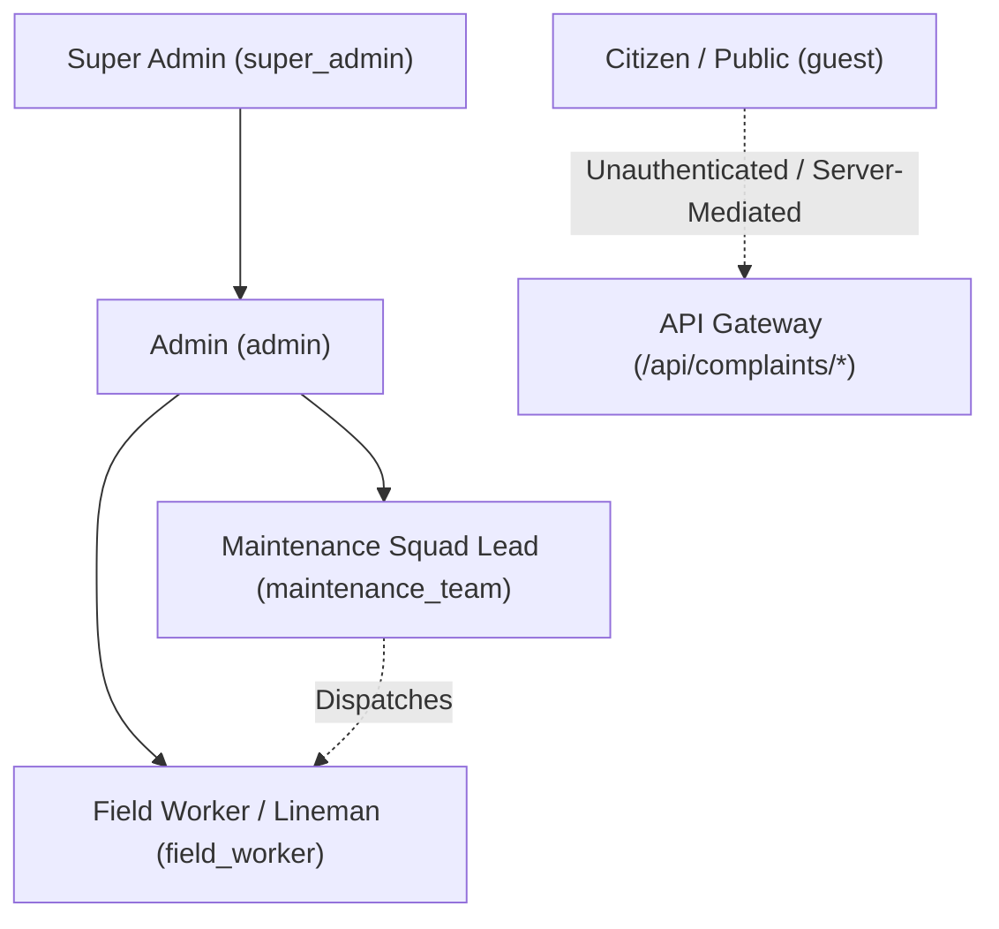
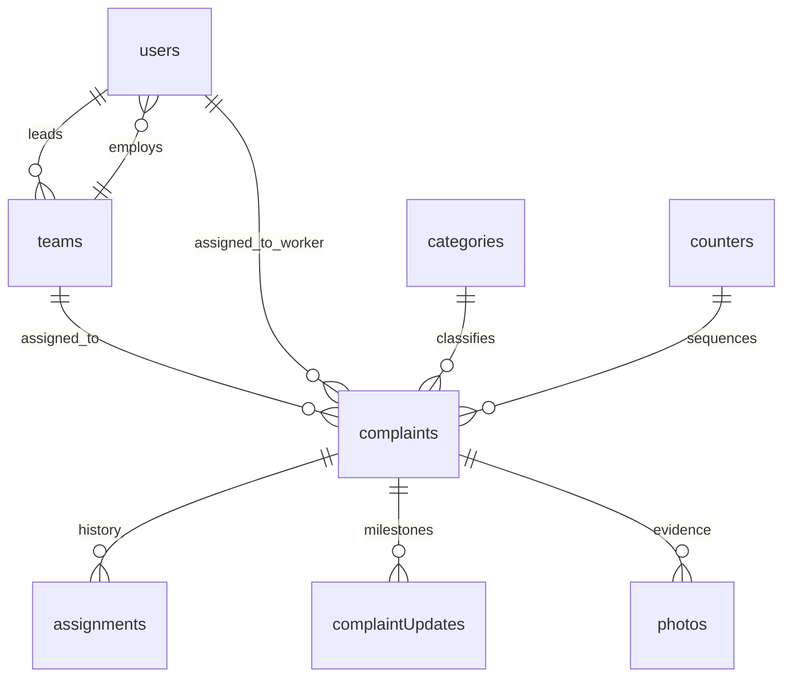
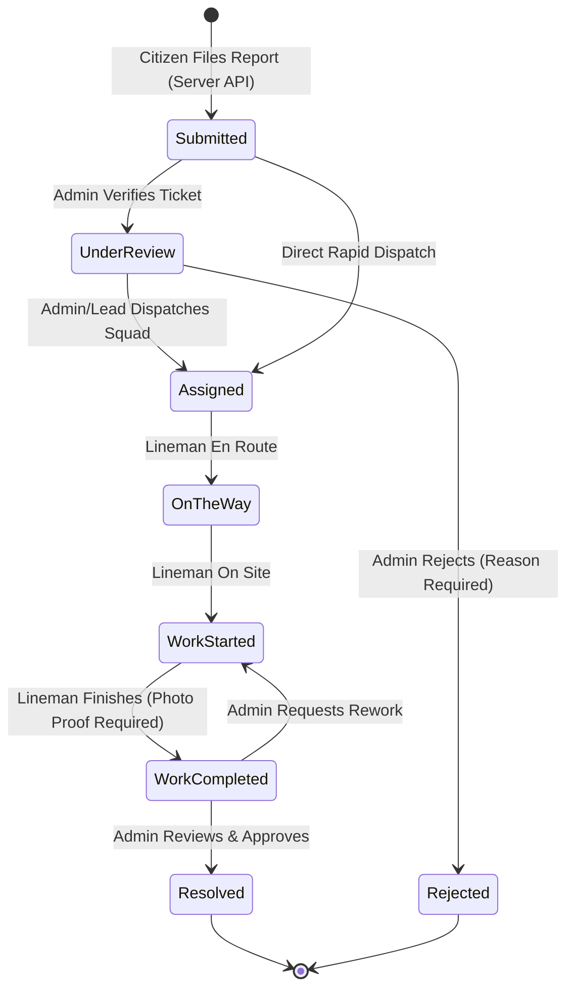

# UrjaSetu 2.0 — Firestore Database Architecture & Security Specification

**Version:** 2.0.0 (Stage 2 Migration)  
**Database:** Cloud Firestore (Native Mode, Production)  
**Region:** Mumbai (`asia-south1`)  
**Auth Provider:** Firebase Authentication (Email/Password + Custom Claims)  

---

## 1. Architectural Overview & Design Principles

UrjaSetu 2.0 is a smart municipal energy issue reporting and field coordination platform connecting citizens, municipal administrators, maintenance squads, and field linemen. 

This document defines the production Firestore database schema, role-based access control (RBAC), lifecycle state machines, and operational security boundaries.

### Core Principles
1. **Zero-Trust Role Enforcement via Firebase Custom Claims**: Role authorization relies exclusively on cryptographically verified JWT tokens (`request.auth.token.role`). Roles passed in HTTP request bodies or stored in freely editable client documents are never trusted by security rules.
2. **Default-Deny Policy**: All Firestore reads and writes are denied by default (`match /{document=**} { allow read, write: if false; }`). Only explicitly authorized paths and operations are permitted.
3. **No Direct Public Writes to Core Ledger**: Citizens do not have accounts and do not execute raw writes or unrestricted queries directly against the `complaints` collection from client browsers. Citizen complaint registration and ticket tracking are mediated through secure server-side API endpoints (Next.js Route Handlers / Cloud Functions) using the Firebase Admin SDK.
4. **Strict Complaint State Machine**: Field technicians can advance work only through `Assigned` &rarr; `On the Way` &rarr; `Work Started` &rarr; `Work Completed`. **Work Completed never automatically resolves.** Official closure requires administrative review and sign-off.
5. **Separation of Public vs. Internal Data**: Internal operational directives, safety alerts, and lineman notes are marked `isInternal: true` and excluded from public citizen tracking timelines.
6. **Immutable Audit Trails**: Historical assignment logs (`assignments`), status changes (`complaintUpdates`), and platform actions (`auditLogs`) are append-only. Updates and deletions are blocked by security rules.
7. **Atomic Sequential Ticket IDs**: Ticket reference IDs (e.g., `URJ-2026-000101`) are generated sequentially via atomic server-side transactions against the `counters` collection. Permanent IDs are never generated by frontend code.

---

## 2. Role Hierarchy & Custom Claims Specification

Firebase Authentication custom claims are assigned to staff accounts via the Firebase Admin SDK.



| Role | Auth Claim (`request.auth.token.role`) | Additional Claims | Operational Scope |
| :--- | :--- | :--- | :--- |
| **Super Admin** | `'super_admin'` | `staffId: "SUP-xxx"` | Full platform administration. Manages Admins, Staff, Teams, Categories, Website Content, and reviews system-wide Audit Logs. |
| **Admin** | `'admin'` | `staffId: "ADM-xxx"` | Municipal dispatch desk. Triages complaints, assigns squads, reviews completion photos, approves resolutions (`Resolved`), or rejects tickets (`Rejected`). **Cannot** modify Super Admin accounts. |
| **Maintenance Team** | `'maintenance_team'` | `teamId: "team-xxx"`, `staffId: "STF-xxx"` | Squad supervisor. Views work orders assigned to their squad (`assignedTeamId == token.teamId`), dispatches linemen (`assignedWorkerId`), and monitors SLA delays. |
| **Field Worker** | `'field_worker'` | `staffId: "STF-xxx"` | On-site lineman. Reads **only** tickets assigned to their UID (`assignedWorkerId == auth.uid`), updates progress, uploads repair proof photos, and reports completion. Cannot mark tickets as `Resolved`. |
| **Citizen** | None (Unauthenticated Guest) | N/A | Submits electrical hazard complaints and tracks complaints via official reference ID. Access is strictly mediated via secure server-side API handlers. |

---

## 3. Collections & Document Schemas



### 1. `users` (Staff & Administrators)
- **Path**: `/users/{userId}`
- **Document ID**: Firebase Authentication UID (`request.auth.uid`).
- **Purpose**: Stores profile and badge metadata for authenticated staff.

| Field | Type | Description |
| :--- | :--- | :--- |
| `uid` | `string` | Matches Firebase Auth UID. |
| `email` | `string` | Official government email address. |
| `fullName` | `string` | Full name of staff member. |
| `role` | `string` | `'super_admin' \| 'admin' \| 'maintenance_team' \| 'field_worker'` |
| `staffId` | `string` | Official badge ID (e.g. `SUP-001`, `ADM-001`, `STF-001`). |
| `phone` | `string` | Contact phone number. |
| `teamId` | `string \| null` | References `teams` document ID (for field staff). |
| `teamName` | `string \| null` | Denormalized team display name. |
| `area` | `string \| null` | Assigned geographical area or municipal zone. |
| `designation` | `string` | Job title (e.g., "Senior Lineman", "Triage Inspector"). |
| `status` | `string` | `'Active' \| 'Deactivated' \| 'Disabled'`. |
| `createdAt` | `Timestamp` | Record creation timestamp. |
| `updatedAt` | `Timestamp` | Last modification timestamp. |
| `lastLoginAt` | `Timestamp \| null` | Most recent authentication timestamp. |

**Security Rules:**
- `read`: User can read their own document; Admins and Super Admins can read all profiles; Team Leads can read profiles belonging to their `teamId`.
- `create / update`: Super Admin can create/update all profiles. Admin can create/update `maintenance_team` and `field_worker` profiles, but is **strictly prevented** from modifying or creating `super_admin` or `admin` profiles. Users can update their own personal non-privileged fields (`phone`, `lastLoginAt`) while being prevented from modifying their own `role`, `status`, or `staffId`.
- `delete`: Denied (`allow delete: if false;`). Accounts must be marked `status: 'Deactivated'`.

---

### 2. `teams` (Maintenance Squads)
- **Path**: `/teams/{teamId}`
- **Document ID**: Unique squad identifier (e.g., `team-rapid`, `team-alpha`).
- **Purpose**: Represents municipal response squads and maintenance zones.

| Field | Type | Description |
| :--- | :--- | :--- |
| `id` | `string` | Team identifier. |
| `name` | `string` | Squad name (e.g., "Rapid Hazard Response Unit"). |
| `description` | `string` | Squad specialization (e.g., "High-voltage lines & fallen poles"). |
| `area` | `string` | Assigned zone (e.g., "Central Ward & Market Square"). |
| `status` | `string` | `'Active' \| 'On Duty' \| 'Standby' \| 'Inactive'`. |
| `leaderId` | `string \| null` | References `users` UID of squad lead. |
| `leadTechnician`| `string` | Display name of lead technician. |
| `phone` | `string` | Squad emergency dispatch phone. |
| `activeTasks` | `number` | Counter of currently open work orders. |
| `createdAt` | `Timestamp` | Creation timestamp. |
| `updatedAt` | `Timestamp` | Modification timestamp. |

**Security Rules:**
- `read`: All authenticated staff.
- `create / update`: Admins and Super Admins.
- `delete`: Denied (`allow delete: if false;`). Deactivation (`status: 'Inactive'`) is enforced.

---

### 3. `complaints` (Core Incident Ledger)
- **Path**: `/complaints/{complaintId}`
- **Document ID**: Official Sequential Reference ID (`URJ-2026-000101`).
- **Purpose**: Primary electrical hazard reporting and lifecycle tracking record.

| Field | Type | Description |
| :--- | :--- | :--- |
| `id` | `string` | Canonical ID (e.g. `URJ-2026-000101`). |
| `category` | `string` | Hazard category (e.g. "Exposed or Sagging Wire"). |
| `categoryId` | `string` | References `categories` document ID. |
| `ward` | `string` | Municipal administrative ward (e.g. "Ward 2 (Market Square)"). |
| `location` | `string` | Street address or pole number identifier. |
| `landmark` | `string` | Nearby physical landmark. |
| `coordinates` | `map \| null` | `{ latitude: number, longitude: number, accuracy: number, detectedAt: string, addressSnapshot: string }` |
| `priority` | `string` | `'Critical' \| 'High' \| 'Medium' \| 'Low'`. |
| `status` | `string` | `'Submitted' \| 'Under Review' \| 'Assigned' \| 'On the Way' \| 'Work Started' \| 'Work Completed' \| 'Resolved' \| 'Rejected'`. |
| `reportedAt` | `Timestamp` | Initial registration timestamp. |
| `reportedBy` | `string` | Citizen name or "Citizen". |
| `phone` | `string` | Citizen contact mobile number. |
| `description` | `string` | Citizen problem description. |
| `assignedTeamId`| `string \| null`| References `teams` ID. |
| `assignedTeam` | `string \| null`| Squad name. |
| `assignedWorkerId`| `string \| null`| References assigned lineman's Auth UID. |
| `assignedWorkerStaffId`| `string \| null`| Lineman badge ID (e.g. `STF-001`). |
| `assignedWorker`| `string \| null`| Lineman full name. |
| `workerCurrentLocation`| `map \| null` | Optional voluntary GPS coordinates shared by lineman. |
| `isDelayed` | `boolean` | SLA violation flag. |
| `photoBefore` | `string \| null`| Primary hazard evidence photo URL. |
| `photoAfter` | `string \| null`| Lineman on-site repair proof photo URL. |
| `citizenPhotoCount`| `number` | Count of attached citizen photos. |
| `resolutionNotes`| `string \| null`| Lineman site repair description. |
| `rejectionReason`| `string \| null`| Mandatory explanation if ticket was rejected by Admin. |
| `approvedBy` | `string \| null`| Admin name who approved resolution. |
| `approvedAt` | `Timestamp \| null`| Admin resolution approval timestamp. |
| `createdAt` | `Timestamp` | Server creation timestamp. |
| `updatedAt` | `Timestamp` | Server modification timestamp. |

**Security Rules:**
- `read`: Admins/Super Admins read all; Maintenance Squads read tickets where `assignedTeamId == token.teamId`; Field Workers read tickets where `assignedWorkerId == auth.uid` or `assignedWorkerStaffId == token.staffId`.
- `create`: Denied directly via client SDK (`allow create: if false;`). Enforced through server-side Route Handler with counter transaction.
- `update`:
  - **Admins**: Full update authority (triage, squad assignment, priority, approval, rejection).
  - **Maintenance Team Leads**: Can assign/reassign linemen within their squad (`assignedTeamId == token.teamId`); cannot reassign to another squad (`request.resource.data.assignedTeamId == resource.data.assignedTeamId`); cannot approve resolution (`status != 'Resolved'`).
  - **Field Workers**: Strictly limited to their assigned ticket (`assignedWorkerId == auth.uid` or `assignedWorkerStaffId == token.staffId`). Status can only advance to `Assigned`, `On the Way`, `Work Started`, or `Work Completed`. Cannot set `status == 'Resolved'`. Cannot alter squad or worker assignment.
- `delete`: Denied (`allow delete: if false;`).

---

### 4. `assignments` (Dispatch & Reassignment Ledger)
- **Path**: `/assignments/{assignmentId}`
- **Document ID**: Auto-generated or `asg_{complaintId}_{timestamp}`.
- **Purpose**: Tamper-proof historical audit trail of all squad and technician assignments.

| Field | Type | Description |
| :--- | :--- | :--- |
| `id` | `string` | Assignment record ID. |
| `complaintId` | `string` | References `complaints` ID. |
| `teamId` | `string` | References `teams` ID. |
| `teamName` | `string` | Name of squad dispatched. |
| `workerId` | `string \| null` | UID of assigned technician. |
| `workerStaffId` | `string \| null` | Badge ID of assigned technician. |
| `workerName` | `string \| null` | Name of assigned technician. |
| `assignedBy` | `string` | Name of assigner. |
| `assignedByUid` | `string` | UID of assigner. |
| `assignedByRole` | `string` | Role of assigner. |
| `assignedAt` | `Timestamp` | Timestamp of assignment. |
| `notes` | `string \| null` | Triage or coordination instructions. |

**Security Rules:**
- `read`: Authenticated staff.
- `create`: Admins and Maintenance Team Leads.
- `update / delete`: Denied (`allow update, delete: if false;`). Strictly append-only.

---

### 5. `complaintUpdates` (Timeline Milestones & Internal Directives)
- **Path**: `/complaintUpdates/{updateId}`
- **Document ID**: Auto-generated.
- **Purpose**: Stores progress updates, milestone logs, and internal staff directives.

| Field | Type | Description |
| :--- | :--- | :--- |
| `id` | `string` | Update record ID. |
| `complaintId` | `string` | References `complaints` ID. |
| `stage` | `string` | Milestone label (e.g. "Work Started", "Approved"). |
| `previousStatus`| `string \| null`| Previous complaint status. |
| `newStatus` | `string` | New complaint status. |
| `note` | `string` | Progress notes or technical instructions. |
| `actor` | `string` | Display name of actor. |
| `actorUid` | `string` | UID of actor. |
| `actorRole` | `string` | Role of actor. |
| `isInternal` | `boolean` | **If true, excluded from citizen public tracking.** |
| `timestamp` | `Timestamp` | Timestamp of update. |

**Security Rules:**
- `read`: Admins read all; Linemen and Squads read updates for their assigned tickets. Citizen tracking reads via server-side API filtering `isInternal == false`.
- `create`: Authenticated staff.
- `update / delete`: Denied (`allow update, delete: if false;`). Immutable.

---

### 6. `photos` (Evidence & Proof Metadata)
- **Path**: `/photos/{photoId}`
- **Document ID**: Auto-generated.
- **Purpose**: Metadata for photos stored in Firebase Storage.

| Field | Type | Description |
| :--- | :--- | :--- |
| `id` | `string` | Photo ID. |
| `complaintId` | `string` | References `complaints` ID. |
| `type` | `string` | `'citizen_evidence' \| 'resolution_proof'`. |
| `fileName` | `string` | Original file name. |
| `storagePath` | `string` | Path in Cloud Storage (`complaints/{id}/{filename}`). |
| `downloadUrl` | `string` | HTTPS download URL. |
| `fileSize` | `number` | Size in bytes. |
| `contentType` | `string` | MIME type (`image/jpeg`, `image/png`, `image/webp`). |
| `uploadedBy` | `string` | UID or "Citizen Guest". |
| `uploadedAt` | `Timestamp` | Upload timestamp. |

**Security Rules:**
- `read`: Authenticated staff.
- `create`: Authenticated staff (for resolution proof) or Server API (for citizen evidence).
- `update`: Admin only.
- `delete`: Denied (`allow delete: if false;`).

---

### 7. `categories` (Hazard Types & SLA Rules)
- **Path**: `/categories/{categoryId}`
- **Document ID**: Slug (e.g. `cat-damaged-pole`, `cat-sagging-wire`).
- **Purpose**: Dynamic category list editable by Super Admin.

| Field | Type | Description |
| :--- | :--- | :--- |
| `id` | `string` | Category identifier. |
| `name` | `string` | Category display name. |
| `description` | `string` | Public guidance on what constitutes this hazard. |
| `severity` | `string` | Default SLA priority (`'Critical' \| 'High' \| 'Medium' \| 'Low'`). |
| `isActive` | `boolean` | If false, hidden from citizen report dropdown. |
| `order` | `number` | Sort display order. |
| `createdAt` | `Timestamp` | Creation timestamp. |
| `updatedAt` | `Timestamp` | Modification timestamp. |

**Security Rules:**
- `read`: Public (`allow read: if true;`).
- `create / update`: Admins and Super Admins.
- `delete`: Denied (`allow delete: if false;`). Categories must be deactivated (`isActive: false`) to protect historical complaints.

---

### 8. `websiteContent` (Public CMS & Civic Information)
- **Path**: `/websiteContent/main`
- **Document ID**: Singleton `main`.
- **Purpose**: Editable homepage text, emergency numbers, safety rules, and public announcements.

| Field | Type | Description |
| :--- | :--- | :--- |
| `heroTitle` | `string` | Homepage hero heading. |
| `heroSubtitle` | `string` | Homepage hero sub-text. |
| `heroBadge` | `string` | Official civic service badge label. |
| `reportButtonLabel` | `string` | Primary CTA label. |
| `trackButtonLabel` | `string` | Secondary CTA label. |
| `emergencyNotice` | `string` | Public safety advisory banner text. |
| `emergencyHotline` | `string` | Emergency numbers (`1912 / 112`). |
| `safetyRules` | `array<map>` | `[{ id, rule, detail, severity }]` |
| `publicAnnouncements` | `array<map>` | `[{ id, title, content, date, active }]` |
| `updatedAt` | `Timestamp` | Last edited timestamp. |
| `updatedBy` | `string` | Name of Super Admin editor. |

**Security Rules:**
- `read`: Public (`allow read: if true;`).
- `write`: Super Admin alone (`allow write: if isSuperAdmin();`).

---

### 9. `auditLogs` (Security & Operations Audit Ledger)
- **Path**: `/auditLogs/{logId}`
- **Document ID**: Auto-generated.
- **Purpose**: Immutable security audit trail recording staff actions.

| Field | Type | Description |
| :--- | :--- | :--- |
| `id` | `string` | Unique log ID. |
| `timestamp` | `Timestamp` | Server timestamp of action. |
| `actorId` | `string` | Auth UID of staff member. |
| `actorName` | `string` | Full name of actor. |
| `actorRole` | `string` | Role of actor. |
| `action` | `string` | Machine-readable action code (e.g. `DISPATCH_TICKET`, `APPROVE_RESOLUTION`, `DEACTIVATE_USER`). |
| `targetType` | `string` | `'user' \| 'team' \| 'complaint' \| 'system' \| 'auth' \| 'content' \| 'category'`. |
| `targetId` | `string` | Identifier of affected entity. |
| `details` | `string` | Human-readable audit narrative. |
| `ipAddress` | `string \| null`| Client IP (if logged via server API). |

**Security Rules:**
- `read`: Admins and Super Admins.
- `create`: Authenticated staff matching `request.resource.data.actorId == request.auth.uid`.
- `update / delete`: Denied (`allow update, delete: if false;`). Tamper-proof.

---

### 10. `counters` (Sequential ID Generator)
- **Path**: `/counters/complaints`
- **Document ID**: `complaints`.
- **Purpose**: Stores the current atomic sequence counter for complaint ticket generation.

| Field | Type | Description |
| :--- | :--- | :--- |
| `currentYear` | `number` | Calendar year (e.g. `2026`). |
| `lastSequenceNumber` | `number` | Monotonically increasing integer (e.g. `105`). |
| `updatedAt` | `Timestamp` | Timestamp of last sequence increment. |

**Security Rules:**
- `read / write`: Denied from client SDKs (`allow read, write: if false;`). Accessed exclusively by the server-side ticket generation transaction using the Firebase Admin SDK.

---

## 4. Complaint Lifecycle State Machine



### Lifecycle Constraints Enforced in `firestore.rules`:
1. `Submitted` &rarr; Generated exclusively by server-side transaction.
2. `Work Completed` &rarr; Can be set by the assigned lineman, but **can never be transitioned directly to `Resolved` by the lineman**.
3. `Resolved` &rarr; Can **only** be set by `admin` or `super_admin`.
4. `Rejected` &rarr; Can **only** be set by `admin` or `super_admin` with a populated `rejectionReason`.

---

## 5. Deployment Guide & Firebase Commands

### Prerequisites
Install the Firebase CLI and log into your Google/Firebase account:
```bash
npm install -g firebase-tools
firebase login
```

### Associate Project
```bash
firebase use urjasetu-v2
```

### Deploy Firestore Security Rules & Indexes
```bash
# Deploy both Rules and Composite Indexes
firebase deploy --only firestore

# Or deploy individually:
firebase deploy --only firestore:rules
firebase deploy --only firestore:indexes
```

---

## 6. Security Analysis & Open Concerns

1. **Custom Claims Provisioning**:
   - Because Firestore security rules enforce `request.auth.token.role`, staff accounts created in Firebase Authentication must have their custom claim set via a secure backend script or Cloud Function (e.g. `admin.auth().setCustomUserClaims(uid, { role: 'admin', staffId: 'ADM-001' })`).
   - If a user signs up without custom claims, they will have `request.auth.token.role == null`, which is safely blocked by our default-deny rules.
2. **Next.js Public API Gateways for Citizens**:
   - In Stage 3, Next.js Route Handlers (`/api/complaints/submit` and `/api/complaints/track`) must be implemented with Firebase Admin SDK so citizens can submit complaints and track tickets without exposing Firestore credentials or opening client-side permissions.
3. **Storage Security Rules**:
   - Storage rules (`storage.rules`) should be created to mirror the Firestore permissions for image evidence upload and download.
